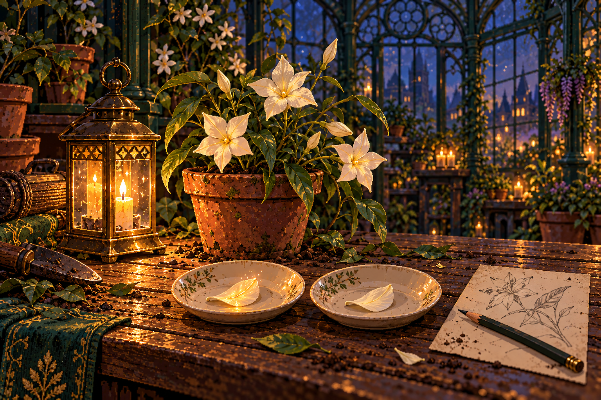

# 4. A lantern for the lost

Chapter IV · Emberfall · 2026-10-31

Generated from [the game source](../src/story/emberfall.mjs) by `npm run export:story`. Edit the source and regenerate. All alternatives are included and labelled below; a player sees only their selected path.

## An afternoon already promised

*2026-10-31 · glasshouses*

October has changed the academy in small, persistent ways. Wet coats occupy the hooks nearest the doors. The trees outside the library have become easier to see through. You can keep a Kindle flame steady while someone asks you a question, which would have seemed an unreasonable demand in September. The cold lantern above your supper place still carries its red ribbon. There have been more inspections, but no one has mistaken the passage of time for a repair.

On Emberfall afternoon, the glasshouse benches are covered in half-built lantern frames. Sunlight catches in the ornate green ironwork and makes every loose brass strip look finished. The illusion lasts until Saoirse picks one up. Its handle slides through the fastening and drops into a pot of soil. She looks at the empty place in her hand, then at you, then very deliberately puts the frame down.

**Saoirse (amused):** You have arrived at an excellent moment. We have discovered that a lantern needs to remain attached to its handle. Several of my earlier drawings were rather optimistic about this.

Rhys moves a tray of moonflowers away from the loose metal. White star-shaped blossoms rest among narrow leaves. Under a nearby glass dome, an ordinary lamp keeps the air warm around a cutting. There is plenty growing here that has nothing to do with your mystery. Rhys makes room for it before she makes room for your notebook.

**Rhys (neutral):** Six sound frames for the west tables. No loose wire, no flame against paper, and no flower picked because someone forgot to collect the fallen petals. We can look at the old botanical reference after the hall has what we promised.

Saoirse’s list says six frames, twelve frames, adjustable shutters, and travelling memory lamp. Each line has a different mark beside it. You ask which marks mean finished. She explains that one means parts found, another means probably possible, and the third is a blot she has been using as a tick. None of them means finished.

> Branch: Compare how much water reaches each pot. (`arrival:watering-method` = `measure`).

The small marked watering tube from your first week is clipped to the shelf. Its measurements are still legible. Saoirse follows your glance and admits that the plant trial became more useful when she stopped changing three things between readings. Then she looks back at the four lines on today’s list, caught by her own example.

> Branch: Try a single outlet before using the whole system. (`arrival:watering-method` = `simplify`).

The plain reservoir from your first glasshouse errand sits beside a healthy tray. The decorative tubing has never returned. Saoirse says the seedlings have shown disappointingly little interest in its absence. When you look at the list of lantern improvements, she looks at the reservoir too, then sighs.

> Older-save fallback: no recorded choice (`arrival:watering-method`).

Saoirse shows you the ordinary reservoir she has been testing on one tray. It has fewer moving pieces than the design pinned above it. The plants have grown. The unfinished design has not. She seems pleased by the first fact and mildly offended by the second.

> All routes rejoin here.

Delphine arrives carrying a covered bowl and a small brush wrapped in cloth. She introduces herself over the edge of the bowl: brewing, mostly useful mixtures, occasionally ones that need a window opened. Her festival contribution is paste that will hold the paper seams and release in warm water when the frames are cleaned. She has written the washing instructions before anyone asks.

**Delphine (neutral):** I can help until the first supper bell. My sister is visiting the village, and I have spent three letters saying that I would come down early enough to see her. I would prefer the fourth letter not to explain why a paper lantern prevented it.

**Saoirse (guarded):** Of course. I only thought, if we had one more pair of hands, the shutters might—

She stops before the request is complete. Delphine has not refused to help; she has said how much help she can offer. Rhys takes a pencil and draws one line beneath the six promised frames. Everything below it can wait. Saoirse watches the line as though a piece of the afternoon has been physically cut away.

The shutters would let a keeper shield a petal without removing it, but their catches are still unreliable. The frames can work with a simple removable cover. Alternatively, you can divide the jobs and finish one adjustable demonstration frame after the six ordinary ones. Delphine will leave at the bell in either case.

**Choice — How will you help make the promise achievable?**

Decision: `emberfall:work-plan`

1. Make six reliable frames with simple covers. (`simple`)
2. Divide the work, then finish one demonstration frame. (`shared`)

> Branch: Make six reliable frames with simple covers. (`emberfall:work-plan` = `simple`).

You move the unfinished catches into a shallow box and write tomorrow on its lid. Saoirse starts to correct the label to after supper, then leaves it alone. She shows you how the removable cover slips into a groove above the lantern glass. There is no clever movement to demonstrate. There is a clear way to tell whether it is in place.

**Saoirse (warm):** If the next person needs me standing behind them to explain it, we have not actually made a lantern they can use. Hand me the plain cover. I shall try to survive its lack of drama.

Delphine brushes paste along a seam and asks you to hold it while she counts. The pause is longer than you expect. She explains that pulling at it early only creates more work later. Saoirse, deprived of moving parts, becomes unexpectedly good at keeping the count. By the fourth frame you have a rhythm that leaves enough silence to hear the owl shifting above the door.

> Branch: Divide the work, then finish one demonstration frame. (`emberfall:work-plan` = `shared`).

You divide the bench into finished frames, frames needing paper, and pieces that are still only ideas. Delphine takes the paper seams. You check each handle with the weight of an unlit lamp inside it. Saoirse finishes the six plain covers before touching the demonstration catch. She crosses out the line for twelve frames herself.

**Delphine (neutral):** I have six seams drying. If the seventh needs another pair of hands after the bell, it will need a different pair from these. I am telling you now while I am still available to be cheerful about it.

With the promised frames finished, Saoirse brings out one shutter. The catch fails twice before she notices that the hinge is pulling against the paper. You hold the empty frame while she moves the fixing to the metal. This time the panel stays where it is put. She writes a cleaning instruction on the card beside Delphine’s. The demonstration is smaller than her first plan, but it can be repeated without her hands.

> All routes rejoin here.

At the first bell, Delphine washes the brush and lifts her bowl. Saoirse looks at the remaining bench, then takes the cloth from her before she can begin cleaning something else. She thanks her by name and tells her which table will have the lanterns. Delphine promises to look on her return. The promise costs her no extra work, so it sounds like pleasure.

**Rhys (warm):** Six frames, six sound handles, and one person leaving when she said she would. You may record all three as completed work.

## Who brought the light

*2026-10-31 · lantern-hall*

The hall has become almost unrecognisable without changing a single wall. Orange lanterns hang beneath the arches; autumn leaves lie in deliberate trails along the tables. Masks rest against the carved birds above the pillars. Through the great round window, the last sunlight turns the mere the colour of a copper pan. The six frames you carry are plain enough to disappear into the splendour, until you remember that disappearing into usefulness is part of their job.

Grey meets you at the west tables. One has been shifted to make a wider passage near the doors. The space is already useful: a student carrying a stack of plates gets through without turning sideways. Grey asks where each lamp should sit before he brings the wire stands. Saoirse asks him to try a handle rather than telling him it is safe.

> Branch: Ask what happens during a handover. (`register:worker-question` = `practice`).

**Grey (neutral):** That copy you brought after the library visit is in the office now. I liked that you put the date above what I told you. Hask asked to read it, and she could see which part was my own account without having to find me in a corridor.

> Branch: Ask how a working keeper is recorded. (`register:worker-question` = `record`).

**Grey (neutral):** Your copy of the handover explanation is with the maintenance notes. The private detail stayed private. Hask asked why there were two signatures, and for once the answer was on the page waiting for her.

> Older-save fallback: no recorded choice (`register:worker-question`).

**Grey (neutral):** Dunne sent over the references for the keeper instructions. I have put a copy beside the current rounds. It helps when a new person wants to know why we wait at the landing after the repair is done.

> All routes rejoin here.

Saoirse listens while he shows you where the lamps will be used. A late arrival will come through the west doors, see the table, and be met before wandering into the serving line. Grey has arranged a stool for whoever takes that turn. Your lantern is part of an invitation with a person attached to it, rather than a decoration expected to do all the welcoming alone.

> Branch: Make six reliable frames with simple covers. (`emberfall:work-plan` = `simple`).

Grey removes a cover, checks the glass, and slides the cover back into its groove without asking Saoirse to explain. She follows the motion with visible relief. The most useful part of the test is that she has nothing to add. You put the cleaning card beneath the spare covers, where the person closing the hall will find it.

> Branch: Divide the work, then finish one demonstration frame. (`emberfall:work-plan` = `shared`).

You keep the adjustable demonstration frame separate from the six table lamps. Grey reads its card, tries the catch, and asks whether the hinge can be cleaned without taking the paper off. Saoirse shows him the fixing she changed. He repeats the movement successfully. The question that might once have spoiled her demonstration has improved the handover.

> All routes rejoin here.

A small card has been left on the table for the makers’ names. Saoirse writes her own, then yours, then Delphine’s. Grey says the paste will be very welcome when he has to clean the frames. She adds a note about where its washing instructions are kept. You remember the empty register cells and find yourself pleased by a card that lists a person beside the part of the work they actually did.

Imogen arrives with three plates and an expression of stern logistical satisfaction. She has decided that carrying supper to the people still arranging lamps is a more efficient intervention than waiting for them to remember it exists. She gives you the plate with a corner of bread balanced over the vegetables, then looks at the makers’ card.

> Branch: Work through the wording with her first. (`register:correction` = `private`).

**Imogen (warm):** Maelin’s replacement note reached the class. I used the wording we worked out together. I still felt nervous handing it over, but at least I was nervous about something I meant.

> Branch: Offer to compare the sources beside her. (`register:correction` = `together`).

**Imogen (warm):** Maelin used our reference numbers in the replacement note. I read them aloud again before the class started. Your part of the explanation turned out to be rather useful practice.

> Older-save fallback: no recorded choice (`register:correction`).

**Imogen (attentive):** Maelin has circulated a corrected note about the keeper records. It includes the working sources now. The explanation is longer, but there are more people in it.

> All routes rejoin here.

For a while there is no investigation. Rowan loses an argument with a paper mask and wears it on the back of his head. Someone at the next table knows a song that half the room knows differently. Saoirse makes a small drawing of the argument between the two versions in the corner of her napkin. You eat while the light changes in the round window. The evening continues without needing you to solve it.

**Saoirse (warm):** Rhys said we could come back after the flowers open. We have time for another song first. The flowers have made no request for punctual applause.

## The flowers keep their own hour

*2026-10-31 · glasshouses*

After the songs, the path to the glasshouses is quiet enough to hear your steps on the grit. The panes no longer throw sunlight across the benches. They hold a dark blue sky, the castle’s distant lamps, and your own faint reflections approaching the door. Inside, the same stools and books occupy the same places. Under the changed light, the white flowers look newly awake.

Rhys is trimming a damaged leaf from a plant unrelated to your visit. She finishes before turning to you. Saoirse sets the small observation lantern on the cleared bench and begins telling her how the handover went. She mentions Delphine’s cleaning card before she describes any part of the mechanism. Rhys listens with a pleased expression that she makes no effort to hide.

**Rhys (neutral):** The old reference describes moonflowers kept near the shore lamps. The present collection includes cuttings from that line, although a cutting is not a record of every person who has touched it. Tonight we will use fallen petals. The plant has already given them up.

You check the soil with Rhys before taking anything from the tray. The surface is dry; underneath, it still holds moisture. Saoirse reaches for the watering can, then puts it back when Rhys shows her where to feel. More water would be an easy thing to offer and the wrong thing to give. You turn the pot a little so the growing tip has room beside the glass.

**Saoirse (attentive):** I kept one fallen petal under a paper cover from the moment it dropped. This one was beside the working lamps when we carried them through. They came from the same plant. I want to know whether a difference stays when the lamp is no longer lighting them.

She lays the petals in separate shallow saucers. The covered specimen is ivory all the way to its tip. The other has a faint amber thread near its centre. It would be easy to call the thread a reflection and easier still to call it a discovery. Rhys asks you to leave enough space on the page for either result. Saoirse has already written the source of each petal at the top.

Two fallen petals lie in separate cream saucers beside the living plant. A faint amber line runs through the petal on the left; the right remains ivory. The small lamp is contained behind glass, apart from the leaves. Nothing is burning. The visible difference is where the investigation begins. By itself it cannot tell you whether the warmth is new, remembered, or only reflected.

There is enough time for a careful comparison before the warmth fades. You can cover the lamp while keeping the petals in place, or exchange the saucers’ positions and then cover the lamp. Rhys will help you separate the steps so you know what you changed.

**Choice — How will you check the difference?**

Decision: `emberfall:observation`

1. Shade the lamp and watch the petals stay in place. (`shade`)
2. Exchange the saucers, then shade the lamp. (`exchange`)

> Branch: Shade the lamp and watch the petals stay in place. (`emberfall:observation` = `shade`).

You lower the cover slowly. Reflections retreat across the rims of both saucers, then vanish from the pencil. The amber thread in the left petal remains. It is much fainter without the lamp, but its outline has not moved. Saoirse starts counting breaths and loses count when she looks at you. You begin again together, without pretending the first count was reliable.

**Saoirse (warm):** There. It is not just the reflection. I would like that to explain everything else, but for the moment I am very pleased that it explains one thing.

> Branch: Exchange the saucers, then shade the lamp. (`emberfall:observation` = `exchange`).

You exchange the saucers without touching either petal. The amber thread moves with its specimen to the right. Saoirse marks the change on the page before you lower the cover. When the reflections disappear, the thread remains where the petal now lies. Nothing has been left glowing on the old patch of wood. Rhys steadies the covered lamp while you check both positions once more.

**Saoirse (warm):** The bench is innocent. That is useful; I had absolutely no plan for taking it down to the shore. Now we can ask what the petal is keeping.

> All routes rejoin here.

The light fades before you have filled half the page. Saoirse’s hand moves toward the lantern, then stops. Adding more warmth now would make it harder to say how long the first trace lasted. She watches the petal go pale. You are surprised by how much patience it takes to let a successful experiment end.

**Rhys (warm):** A short-lived trace is still a trace. We have enough to try Echosight on a second prepared petal. We do not have permission to exhaust the whole plant until it tells us a more impressive story.

## Warmth without a face

*2026-10-31 · glasshouses*

Rhys brings a second fallen petal in a folded paper packet. The packet belongs to the teaching collection, with its source and date written on the outside. It was collected beside a shore lantern after a previous Emberfall. The care note says the flower was tended by several people. No single name is offered as the owner of everything it might remember.

**Rhys (neutral):** We can observe this teaching sample once. Lift your hand if the trace becomes difficult to leave. If you notice a feeling, describe it as a feeling. It cannot give consent for us to invent a whole person around it.

The first impression is warmth at knee height, as if a small fire had been carried close while someone waited. Then comes the rough drag of cloth over a seam. You glimpse a hand pressing a patch flat, but the hand has no face attached to it and the scene does not widen when you try to look. You remember Maelin’s card. You let the trace pass.

There is a brief sense of a kettle being moved to make room, and damp boots on a board that gives slightly underfoot. The impressions overlap without becoming a single room. You cannot tell whether you have seen three moments or pieces of one. Underneath them lies the same patient warmth that made the working ledger feel familiar. It fades when you lift your fingers.

**Saoirse (guarded):** Did it feel like somebody waiting to be found?

You tell her what you noticed: the patch, the kettle, the boots, the warmth. You cannot honestly say that anyone was waiting inside the petal. Saoirse turns her pencil between her fingers. The answer disappoints her, though she has been careful enough to know why it matters.

**Rhys (neutral):** The petal can carry something left by care. It does not carry the person who gave it. Think of a coat kept warm for someone coming in from the rain. The welcome is real. It does not mean its maker is still standing inside the coat.

Saoirse puts the pencil down before answering. She had hoped the travelling lamp might preserve stories people could no longer tell. She can see now how quickly that hope could become a machine that supplies whatever a listener longs to hear. The thought makes her look toward the covered lantern rather than toward you.

**Saoirse (attentive):** Then it needs to hold the trace without pretending to translate it. A cover, a source card, a way to let the warmth go. No little voice making up a name because we dislike an empty space.

You place the clean source card beside the frame. A person carrying the lamp would need to know where its petal came from, when it was gathered, and how long the trace might remain. They would also need to know when to stop. None of those instructions makes the lantern less interesting. They give someone besides its inventor a way to use it without having to guess.

> Branch: Make six reliable frames with simple covers. (`emberfall:work-plan` = `simple`).

The plain cover you chose this afternoon proves useful again. It is easy to see whether it is open or closed, and easy to remove for cleaning. Saoirse writes that on the card. She adds that an adjustable shutter may eventually help, but it is not required for this observation. The distinction seems to cost her less than it would have cost her before supper.

> Branch: Divide the work, then finish one demonstration frame. (`emberfall:work-plan` = `shared`).

The single adjustable frame makes it possible to lower the light gradually, but Saoirse records the plain cover as an alternative. The six working lamps in the hall still matter more than this extra mechanism. She writes that someone should be able to complete the observation without choosing her cleverest design.

> All routes rejoin here.

**Rhys (neutral):** The older plants were kept beside the returning path. Tully may know which shore lamps were tended together. Take him the question when the winter rounds begin. Take a copy of what you actually observed, too. He deserves something more useful than an alarming rumour about haunted flowers.

You add the shore rounds to your notebook. The old register described people working at separate lamps; the flowers may connect those places through a practice that survived longer than its explanation. Tully can show you the route as it is used today. You have a question specific enough to take to him, and an observation he can check.

## An hour with nothing to prove

*2026-10-31 · glasshouses*

Rhys seals the teaching sample, checks the plant labels, and takes the unused petals back to their shelf. The experiment is finished. She leaves the two of you the ordinary job of wiping the bench and tells you where the clean cloths belong. Saoirse looks almost relieved to be given an instruction that cannot become a new invention.

The paste has dried in a pale ring beside the bowl. Warm water softens it exactly as Delphine promised. You hold the bowl while Saoirse wipes, and she tries to remember whether the cleaning card credited Delphine clearly enough. You tell her that Grey read the name aloud. The worry leaves her face slowly, as though it had expected to remain for the evening.

**Saoirse (guarded):** I keep thinking that if I can finish the next useful thing, I will have earned a quiet evening. Then I put another useful thing after it. I suspect there is a fault in the design.

She says it lightly, but she has stopped moving the cloth. You have seen her use a joke to make a difficult sentence easier to carry. This time she does not immediately replace the sentence with another task. Outside the glass, a cloud passes across the moon. The room darkens for a moment without becoming cold.

The bench is clean. The lamp is out. Saoirse folds the cloth square and leaves it beside the sink. You have a little time before you need to return to the hall, and neither of you has promised it to anyone else.

**Choice — What kind of company will you offer?**

Decision: `emberfall:quiet-company`

1. Ask what she hoped the travelling lamp would do. (`listen`)
2. Invite her to spend a little time without a project. (`rest`)

> Branch: Ask what she hoped the travelling lamp would do. (`emberfall:quiet-company` = `listen`).

**Saoirse (guarded):** I wanted a light you could take somewhere that did not feel like home yet. Not one that told you to be grateful. Something that reminded you that you had been expected somewhere before, and might be expected again.

You ask whether she has had a place like that. She looks at the stools, the crowded benches, and the plant that has somehow grown around the foot of a bookstand. This room, she says, but not immediately. At first she kept volunteering for things because she could understand being needed more easily than being wanted. She does not give you a larger story than she is ready to tell.

**Saoirse (shy):** I am trying to learn the difference. Rhys keeps giving me seedlings that do not need anything until tomorrow. I think it may be a deliberate teaching method.

You tell her that you came back after the songs because you wanted to spend the evening here. The observation mattered, but it was not the only reason. Saoirse studies the folded cloth while she takes that in. Then she nudges the empty stool toward you. There is no reward hidden inside the gesture, and no request following it.

> Branch: Invite her to spend a little time without a project. (`emberfall:quiet-company` = `rest`).

You sit on the empty stool and suggest an experiment that requires no equipment: a few minutes in which neither of you improves anything. Saoirse says that making it an experiment is a rather unfair way to make her interested. She sits anyway. For the first minute she notices three things she could mend and tells you about none of them.

**Saoirse (warm):** The sound the hall makes when everybody knows the next line of a song. The smell of the first orange someone opens in winter. A clean pair of socks that nobody has warmed with a spell. Apparently I have a great deal to say about socks.

She asks what you would put on the list and waits while you think. There is no correct kind of ordinary pleasure to offer her. The small pause matters more than a perfectly chosen answer. You can look through the glass at the scattered academy lights without having to turn them into evidence. Saoirse follows your gaze and, for once, leaves the silence whole.

**Saoirse (amused):** We should do this again. I would make a timetable, but I worry that would count as improving something. Perhaps I shall simply ask whether you are free.

> All routes rejoin here.

When you stand, Saoirse leaves the box marked tomorrow where it is. She checks that the lantern is cool, takes the copy intended for Tully, and turns down the nearest lamp. The room does not need to become empty of unfinished things before you are allowed to leave it. That feels like a useful lesson, though neither of you calls it one.

## One line left

*2026-10-31 · corridor*

The corridor outside the hall carries the muffled rhythm of a final song. Someone has hung a paper lantern in the deep window recess, safely clear of the curtain. Rowan is waiting by the door with the last two slices of a cake that has suffered structurally but remains promising in every other respect.

**Rowan (amused):** I defended these from a perfectly reasonable argument about sharing. Please eat them before I begin to agree with it.

Delphine comes up the corridor just as you finish the first bite. Her sister has gone back to the village with a lantern drawing on the back of an envelope. She saw the west tables on her way in and found the cleaning card where you said it would be. Saoirse asks how the visit went before asking anything about the paste. Delphine notices the order, and her answer becomes a little longer.

**Delphine (neutral):** We walked nowhere in particular and argued about whose turn it was to write first. I have been trying to brew the feeling of opening a letter. This was a useful reminder that sometimes you can simply go and see the person.

The remaining lantern paper is waiting on the small corridor table. The six frames are in use, the comparison has a written record, and the next shore question is safe in your notebook. What remains is a line for the Emberfall lantern you made together. It does not have to explain the entire mystery. It only has to be a promise you are prepared to carry.

**Saoirse (warm):** Leave a little space at the edge. Someone might think of a better way to say it when we are older. I would like the lantern to have room for that.

You smooth the paper beside the small waiting flame. Beyond the door, the hall is beginning to settle: chairs drawn in, cups gathered, the welcoming stool still occupied. The ordinary work of the festival is not finished when the celebration ends. This time, you know who will stay to finish it.

## Chapter exit choices

1. Write: No kindness is too small to remember.
2. Write: We will make room for everyone.
