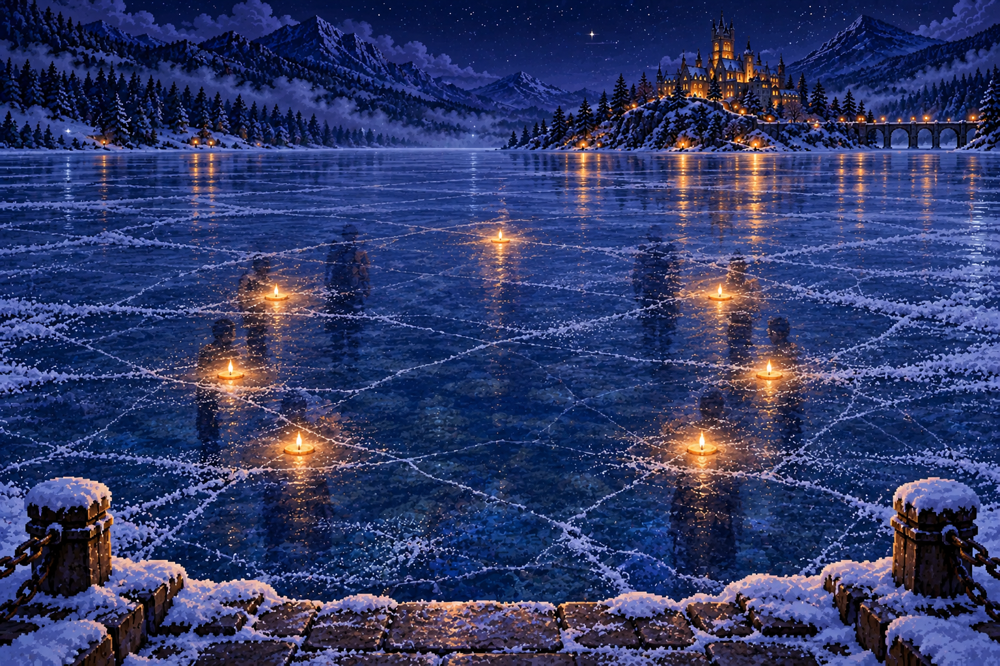

# 5. The lake remembers

Chapter V · Longnight · 2026-12-21

Generated from [the game source](../src/story/longnight.mjs) by `npm run export:story`. Edit the source and regenerate. All alternatives are included and labelled below; a player sees only their selected path.

## The work of arriving

*2026-12-21 · tully-cottage*

Winter has made Tully’s cottage smaller from a distance and more complicated up close. Snow rounds the roof and gathers in the seams of the barrels. The path to the covered workbench has been swept, gritted, and swept again. Beyond the tied boats, a narrow patch of dark water moves against the frozen mere. The academy shines across it. Walking here from the bridge has taken longer than you expected.

Tully is adjusting a lamp beneath the porch. He finishes tightening its catch before greeting you. There are three mugs waiting beside the kettle, and a fourth upside down to keep snow out. Saoirse puts her case on the bench. She has brought the small lantern you worked on at Emberfall, a roll of spare cloth, and exactly one tool more than the case will hold.

**Tully (warm):** Good. You came by the upper path. The boats are tied up for the freeze. Anyone arriving for Longnight gets met at the bridge and walked round. We keep a lamp at both turns. The castle is easy to see; the safe way to it is another matter.

The first page on his workbench lists expected arrivals, the times they might reach the bridge, and who will meet them. Several times are crossed out. Beside one name, Tully has written that the visitor cannot carry a heavy bag. Beside another is a reminder to bring a spare coat. He turns the sheet face down before clearing space for your notebook. These are people’s arrangements, not a puzzle to be copied.

> Branch: Ask what she hoped the travelling lamp would do. (`emberfall:quiet-company` = `listen`).

**Saoirse (warm):** Remember what I said about wanting a light to feel as if somebody expected you? Tully has a list, a spare coat, and someone waiting at the bridge. I think I left a few important parts out of my drawing.

> Branch: Invite her to spend a little time without a project. (`emberfall:quiet-company` = `rest`).

**Saoirse (amused):** I have taken your lesson about doing nothing extremely seriously. There is a whole hour after supper with no invention in it. I am telling you now so I cannot quietly fill it with something useful later.

> Older-save fallback: no recorded choice (`emberfall:quiet-company`).

Saoirse asks which of the mugs is yours. She has been practising fitting her work around other people’s plans, with mixed success. Tonight she has left the hour after supper empty. She says this with the solemn pride of someone presenting a very small invention.

> All routes rejoin here.

Boots scrape on the lower step. Kestrel arrives carrying a flat case and a folded survey. She sets the case where melting snow cannot reach it, introduces herself as the teacher responsible for tonight’s warding check, and asks Tully about the returning bridge party. Only after he gives the time does she ask to see your autumn notes.

**Kestrel (neutral):** Rhys sent me her account of the petal comparison. A short-lived trace can tell us where to look. Tonight we are checking whether the older shore memory is still readable. I will hold the boundary of the exercise. You may stop your spell whenever you need to.

A porch lamp flickers while she speaks. Saoirse looks up sharply. Tully gives the catch another quarter-turn. The flicker stops. A strip of worn metal lies beside his tool, its edge rubbed thin by years of use. There is something reassuring about a fault that fits in a hand and can be replaced before supper.

**Tully (neutral):** That one was the fitting. I still mend fittings. The shore lamps have been losing their welcome even when the fittings are sound. Two jobs. If we forget the first while thinking about the second, somebody misses a step.

The lake reading will take place from the old stone landing, inside the rope posts. Tully wants the route ready for the next arrival as well as for your investigation. He offers you the route slate and the box of lamp catches. Kestrel will accompany either job and then check the exercise boundary. Saoirse takes whichever task remains.

There is time to complete one useful piece of the round before you go to the water. One task concerns how a stranger finds the route; the other concerns whether the lamps marking it keep working.

**Choice — Which part of the round will you take?**

Decision: `longnight:shore-work`

1. Check the route as someone arriving for the first time. (`landmarks`)
2. Check the catches and covers on the route lamps. (`lanterns`)

## A path somebody can use

*2026-12-21 · tully-cottage*

> Branch: Check the route as someone arriving for the first time. (`longnight:shore-work` = `landmarks`).

You begin at the bridge end and pretend that the castle’s bright windows are the only directions you have. At the first fork, the lower track points more directly towards them. Its old gate is half hidden by snow. The safe upper path curves away into trees. From here, the inviting choice is wrong.

**Kestrel (neutral):** Tell me what made you choose it. We know the route, which makes us poor judges of how clear it is. “Obvious” often means somebody explained it to us years ago.

You describe the sightline, then walk back until the fork disappears behind the tree. Tully moves the marker to the place where a newcomer would actually make the decision. You help turn its arrow towards the upper path. Saoirse tests the hood above it, and you return to the bridge end to check again. This time the marker is visible before the tempting track.

**Tully (warm):** That earns its place. I have walked past it all winter knowing what it meant. Next person gets a better chance than that.

> Branch: Check the catches and covers on the route lamps. (`longnight:shore-work` = `lanterns`).

Tully shows you the first catch before letting you handle the next. With the lamp cold and supported, you check the hinge, the cover, and the little hook that holds them together. Most are sound. One catch closes with a satisfying click and opens again when you gently pull. The sound had been more convincing than the fastening.

**Kestrel (neutral):** Show me the test again. Good. A check should be something another person can repeat. We will put that motion on the round sheet, rather than “make sure it seems secure.”

You hold the lamp steady while Tully replaces the hook. Saoirse passes the correct spare from the box without trying to redesign it. When the new catch closes, you repeat the pull. This time it holds. The old piece goes into a marked envelope for Jory, who supplies the replacements. Tully wants him to see the wear before anyone orders a dozen more.

**Tully (warm):** That will save a cold walk back with a loose cover. Put your initials beside the check. When Jory asks what happened, he can ask the person who actually tested it.

> All routes rejoin here.

A voice calls from the bridge. Tully raises his hand to the student escort bringing two visitors around the turn. You stand aside while they pass. One visitor is laughing at a story; the other is concentrating on their feet. Neither knows about the record discrepancy or the petals. Both benefit from the little work you have just finished.

The escort carries the heavier bag. Tully asks whether they want to rest at the cottage or continue up to the hall. They choose the hall, where someone is keeping supper warm. He waits until they reach the next lamp before turning back to you. The waiting is part of the work, and it cannot be made quicker by looking busy.

**Tully (neutral):** My first winter, I took the lamps down as soon as the last expected boat came in. My predecessor asked how I knew nobody unexpected would arrive. I did not have a good answer. Now the final round is a handover, not an assumption that everybody is home.

At the old landing, Kestrel checks the stone under the snow, then the posts, then the line between them. The boats remain tied at the cottage. Nobody is crossing the ice. She places two small ward markers on the dry side of the rope and leaves enough clear space for you to step back. Tully stays where he can watch the route as well as the exercise.

**Kestrel (neutral):** A narrow reading. Choose the water beyond the landing as your subject, then let the older trace come into view without reaching for it. If you become cold or dizzy, lower your hand and say so. I will close the reading. No observation requires you to endure it at any cost.

Saoirse opens her lantern case on a dry stone. The instrument is only a steady reference light tonight; it will not pull anything out of the lake. She sets a blank page beside your notebook and weighs both down. Your fingers already feel clumsy inside their gloves. Kestrel asks you to move them and checks your answer before she begins.

> Branch: Make six reliable frames with simple covers. (`emberfall:work-plan` = `simple`).

The plain removable cover from Emberfall fits around the reference lamp. Saoirse folds it back with two fingers. The modest design is easy to use in gloves, which had not been part of your original reasoning. She looks pleased enough to add it to the list now.

> Branch: Divide the work, then finish one demonstration frame. (`emberfall:work-plan` = `shared`).

Saoirse tries the adjustable cover you helped keep in the Emberfall plan. Its little lever is awkward in gloves. She uses the plain spare cover instead and writes “larger handle” on a separate scrap. The investigation page remains clear. A design can be worth keeping and still need changing.

> Older-save fallback: no recorded choice (`emberfall:work-plan`).

The reference lamp has a plain cover that Saoirse can fold back without removing her gloves. She tests it once, sets it beside the case, and leaves the experiment itself to you. Her notebook has room for a sketch and for what the sketch cannot show.

## What the water has kept

*2026-12-21 · mere*

Snow has softened the boathouse roof across the bay. Beyond it, the academy’s windows make broken golden lines on the ice. The ordinary shore lamps burn above the surface, where Tully hung them. You identify those first. Their reflections move when you move your head. The older memory, if it answers, will have to be distinguished from all that present light.

You settle your feet on the cleared stone and raise your hand. Echosight starts as a slight doubling at the edge of a reflected window. Kestrel asks you to narrow your attention. You let the castle blur. A different warmth gathers below the surface, far closer than the buildings, and the first small flame becomes visible.

**Saoirse (attentive):** One at the far side. Three down the left. Three down the right. There is a gap towards us. I am counting the small lights, not the windows.

Seven small amber flames form an open ring within the lake’s echo: one at the far end and three on each side, leaving a gap nearest the landing. Faint human-shaped reflections stand beside them, with no clear faces. Snow and blue ice remain visible through the memory. You are on the stone landing behind the boundary; no one is standing on the ice.

A sound comes with the last light. It might first be mistaken for a rope running through a hand: a soft roughness, then several breaths taken at different times. The figures resolve just enough for you to see arms lifting. Each small flame waits apart from the others. None is drawn into place by a central fire.

**Kestrel (neutral):** I can hold this reading for a little longer. Choose what you will record closely. Saoirse, take the other part. We will compare after closing, while both accounts are still fresh.

There is more happening than one person can write at once. The arrangement of the lights and the fragment of speech both matter. You and Saoirse can divide the observation without trying to make either account complete.

**Choice — What will you attend to?**

Decision: `longnight:echo-record`

1. Follow how each separate light joins the open ring. (`pattern`)
2. Listen for the words spoken as the lights are offered. (`words`)

> Branch: Follow how each separate light joins the open ring. (`longnight:echo-record` = `pattern`).

You mark seven positions. The first light brightens; the others remain dim. Then a second answers. There is no sweep carrying them all together. The near-left flame pauses long enough for your pencil to stop above the page, then joins at its own pace. The opening nearest you stays open. When you try to draw a line across it, your pencil has nothing to follow.

**Saoirse (attentive):** I heard “if you wish.” Then more than one voice answering. I cannot make out the names. You have the order? Good. I nearly made all the answers one sound because I wanted to keep up.

> Branch: Listen for the words spoken as the lights are offered. (`longnight:echo-record` = `words`).

You keep your pencil still for the first breath. A voice says something too faint to catch, then “if you wish.” Silence follows. An answer comes from the left, another from farther away, a third almost over it. You write the clear phrase and leave spaces for what you cannot hear. The last answer arrives after a pause, in its own time.

**Saoirse (attentive):** Seven, joining separately. This one waited. The gap stayed open even after the last light answered. I have drawn it twice because my first sketch made the ring look closed.

> All routes rejoin here.

As the seventh light steadies, a thin dark break crosses the reflected academy. You feel it before you understand what you are seeing: a missing strip where a row of warm windows ought to be. Above the lake, the actual windows remain whole. Saoirse’s pencil drops onto the notebook. Her breath catches sharply enough for Kestrel to hear.

**Kestrel (grave):** Lower your hand. Stay where you are. We have enough for tonight.

You lower your hand. The small flames dim in the order you noticed them, and the figures lose their shape. Kestrel closes the two markers together. The ordinary reflected windows return to their familiar wavering lines. Tully has already opened the way back from the landing. He gives Saoirse her pencil without asking her to bend for it.

**Saoirse (scared):** If the Heartfire goes out, will the school disappear?

**Kestrel (grave):** The buildings will remain. I will explain the rest at the workbench, where your hands can get warm. We are finished with the water.

You close the notebook on a loose sheet so neither observation rubs against the other. Tully collects the ward markers after Kestrel releases them. The return is slower than the outward walk. Nobody calls for another look. The useful thing now is to bring everyone and the work back together.

## What the school would lose

*2026-12-21 · tully-cottage*

The kettle is still warm under its cover. Tully makes fresh tea anyway, giving the water time to heat while you put away the instrument. Saoirse wraps both hands around her mug without drinking. Kestrel waits until you have loosened your gloves and can move your fingers comfortably. Then she unfolds the survey she brought from the academy.

**Kestrel (grave):** The tower, the hall, the dormitories: stone and wood. Okoro and I have checked the protective wards, and Grey has the building reports. The crack you saw was in the remembered reflection. It does not mean the wall is breaking. We are dealing with the welcome held by the Heartfire.

**Saoirse (scared):** That sounds smaller when you say it like that. I do not think it is smaller. The first night I came here, I knew where to turn before I could read the signs. I thought that was just what finding a home felt like.

**Kestrel (neutral):** Part of it was people making a home with you. That remains within our power. Part was the old welcome answering through the lamps: warmth recognising a place kept for you. If it fails, a lamp will still light a path. It will no longer carry that answer.

Tully turns his mug so the chipped side faces away. He says the shore lamps once changed when a tired traveller came around the headland: the light grew steadier, easier to follow without growing harsh. Lately, he has had to watch the turn more carefully himself. He had thought the first missed answer was weather. Then it happened on a clear night.

**Tully (neutral):** We can keep meeting people. We can put a coat over a cold shoulder and carry the bag. I mean to. I would still like to keep what those who came before us made for that work.

Kestrel’s survey has three sets of measurements: early autumn, after Emberfall, and this week. She explains the scale before showing the result. Each measures the welcome’s response to the same small offered light, with the ordinary lamp tested separately. The response has weakened at every set. Your lake reading adds a surviving example of how the older lights joined, rather than another measurement of their present strength.

**Kestrel (neutral):** The annual renewal is at Midsummer, the twenty-first of June. Moth found the old cycle records; my measurements agree with the decline recorded before earlier renewals. This time the reserve is too weak to carry another turn unaided. We need to restore the shared welcome before that renewal passes.

You find the date on the corner of the survey: 21 June, 2027. Six months away. It is far enough to contain lessons, meals, mistakes, and work that cannot be completed tonight. It is close enough to write on the first page of the investigation. You draw a box around it, leaving space below for what must happen before then.

**Saoirse (attentive):** So we have a date. We do not have to make the whole answer before we go to bed. I would have tried. I am telling you because I would have tried.

**Kestrel (neutral):** Honoria is organising the academy’s response. Okoro and I will keep the working wards sound. Hask and Moth are checking the older accounts. Tully will keep the arrival routes running. Your part is to help us understand the small lights and the people who offered them. That is real work. It is not the whole burden.

You write the tasks under the date, each beside the person responsible. Saoirse adds the instrument and its limits under her own name. Tully puts the next winter round under his. Kestrel asks you to leave a blank line for the task you choose. The page begins to look less like a verdict and more like a difficult piece of work that can be shared.

## Something to do before spring

*2026-12-21 · tully-cottage*

You and Saoirse read your lake accounts aloud without changing them first. Kestrel asks about the separate answers, then about the opening in the ring. Tully remembers an old shore chart with a landing marked near the Candlestones. He brings it from a drawer, leaving the visitor list where it is. The two records have different purposes and different people’s business in them.

> Branch: Follow how each separate light joins the open ring. (`longnight:echo-record` = `pattern`).

Your sketch shows the late-joining light and the unclosed gap. Saoirse’s page supplies the short invitation you did not try to catch. Side by side, the accounts preserve more than either of you managed alone. You add a note explaining which page records the sequence and which records the sound. Neither signature belongs on the other person’s observation.

> Branch: Listen for the words spoken as the lights are offered. (`longnight:echo-record` = `words`).

Your page holds “if you wish” between two honest blank spaces. Saoirse’s sketch gives the separate flames somewhere to stand. You mark the delayed answer beside the light she saw join last, noting that the match is probable rather than certain. It is a useful connection even with a question mark still attached.

> All routes rejoin here.

**Kestrel (neutral):** Separate lights, separate answers, an invitation. Taken together, this supports willing participation. We still need the terms of the connection: how they joined and how that opening was kept. Do not fill those in because the arrangement looks familiar.

The chart places the old landing below the Candlestones. From the cottage you can see only the dark shape of their ridge. Snow covers the lower approach, and Tully has closed its gate. He points out the spring path with one finger. When the thaw makes it usable, you can examine the stones with Kestrel and compare their surviving marks with tonight’s echo.

**Tully (neutral):** The ridge can wait for a clear path. We cannot make the weather hurry. We can make sure the right papers and the right people are ready when it opens.

There are two useful jobs available now. Tully needs a clear handover sheet for the winter rounds, including where observations can be made from safe ground. Imogen has asked for a source list connecting the working registers to the shore chart. You can start either at the bench tonight and continue it through the ordinary weeks of term. The other will go on the shared work list.

The investigation needs both practical continuity and a record someone else can follow. Choose a bounded contribution. You will have help, and time for the rest of your life at the academy.

**Choice — Which winter task will you begin?**

Decision: `longnight:winter-duty`

1. Help Tully make the rounds easier to hand over. (`handover`)
2. Prepare the shore sources for Imogen’s spring research. (`archive`)

> Branch: Help Tully make the rounds easier to hand over. (`longnight:winter-duty` = `handover`).

You draw a fresh sheet with spaces for the route, the check, and who receives the next round. Tully tries using it while you watch. At the second line he stops: you have written “usual turn,” which tells a newcomer nothing. You replace it with the bridge fork and the upper marker. On the last line you put a name for the handover, so a finished round cannot quietly become an unattended one.

You add a sketch of the check you completed on the round, with the route direction marked beside it. Tully tries reading the instructions without looking at your hands. Where he has to ask what you meant, you add the missing detail. The sheet needs to work when you are absent.

**Tully (warm):** Bring this on the next round and we will try it with somebody who has not heard us explain it. When the spring path opens, this will tell us where our winter checks ended. We will not have to trust my memory for all of it.

> Branch: Prepare the shore sources for Imogen’s spring research. (`longnight:winter-duty` = `archive`).

You give the shore chart its own line, with the drawer it came from and Tully’s permission to copy it. Below that go the autumn register references and the two lake observations. You leave a space for Imogen to check the links. The first version makes a date look like a keeper’s name; Saoirse catches it when she tries reading the list aloud. You change the headings.

**Tully (neutral):** Copy the old chart, yes. Leave the arrival list here. If somebody needs an account from a current traveller, they can ask that traveller. Those names were given to me for meeting people at the bridge.

You make two copies of the source list, one for Imogen and one to stay beside the chart. Saoirse volunteers to deliver the first on your way to supper. In the margin, you write a spring question: does the approach marked here lead to the same opening seen in the echo? The question is narrow enough that an actual visit could answer it.

> All routes rejoin here.

Kestrel checks that your task has a first step, a person who can help, and somewhere to stop. Then she puts away the survey. Saoirse begins to reach for the lamp lever and catches herself. It can wait until tomorrow. Tully covers the kettle and asks which of you will carry the empty mug crate back up to the hall.

**Tully (warm):** Thank you for the round. And the paper. Leave the future here for the length of the walk, if you can. The mugs need both hands.

## The longest night has a table

*2026-12-21 · lantern-hall*

Blue and white lanterns hang under the hall’s dark rafters. Snowflake shapes turn slowly above the tables, catching amber light from below. Through the round window, the night looks clean and impossibly cold. Inside, somebody has saved four places together without trying to make an announcement of it. You set the mug crate beside the serving table and feel the relief of having carried it all the way.

The meal has been kept in covered dishes. Kestrel goes to speak with Honoria before sitting down; Tully puts his route sheet into his coat and makes himself take the chair facing away from the door. Saoirse notices this and says nothing. A student brings him bread. For a few minutes, the person who waits for arrivals is allowed to arrive.

> Branch: Check the route as someone arriving for the first time. (`longnight:shore-work` = `landmarks`).

One of the visitors from the bridge passes your table on the way to the hearth. They say the upper marker was a help; they had nearly followed the lower track. Tully points to you with his spoon. The visitor thanks you, then continues towards the person they came to see. Your part in their evening is small and complete.

> Branch: Check the catches and covers on the route lamps. (`longnight:shore-work` = `lanterns`).

The student who escorted the visitors pauses beside Tully to report that every route lamp is closed and burning steadily. Tully asks specifically about the repaired catch. It held. Saoirse taps the place where you wrote your initials on the check sheet, then lets the report end. There is no need to make it into a speech.

> All routes rejoin here.

Saoirse has managed half her meal before she takes out the notebook. You see the movement and she stops, smiling ruefully. Instead of opening it, she slides it under the chair. Then she asks whether you prefer the blue lanterns or the orange ones from Emberfall. It is an ordinary question with an answer that will not help solve the mystery.

**Saoirse (warm):** I like these. I think. The orange ones made everything feel close enough to reach. These make the roof look as if it goes on forever. Ask me again after pudding; I may have a completely different theory.

Kestrel returns with a fresh page folded into her case. Honoria will put the next investigation meeting on the term calendar, with time for the staff reports and your winter work. There will still be classes tomorrow. A deadline six months away does not cancel the need to learn what you are doing before you try it.

**Kestrel (neutral):** Your observations are safe in the case. Keep your own copies. If another detail comes back to you later, date it as a later recollection. For tonight, eat while the food is warm. We can ask better questions after sleep.

At the far end of the hall, someone begins a song too softly for everyone to hear. A second voice picks it up, then another. Tully knows the words but hums only the part he likes. Saoirse gets one line wrong and laughs into her sleeve. The sound fills the space where the notebook might have been.

You know more than you did when the evening began. Seven willing lights once joined here. An opening was left for someone else. The welcome is weakening, and Midsummer is the next renewal. You also know where your winter work begins and who will be doing the other parts. The unanswered questions have places to go.

Saoirse rests one hand on the table beside your cup. She has stopped pretending that she is not frightened, and has begun eating again anyway. You can offer her your hand and a promise of company, or put words to the practical plan you will carry into tomorrow. Around you, the longest night continues to make room for supper.

## Chapter exit choices

1. Take her hand and promise to finish this together.
2. Make a careful plan for the work ahead.
